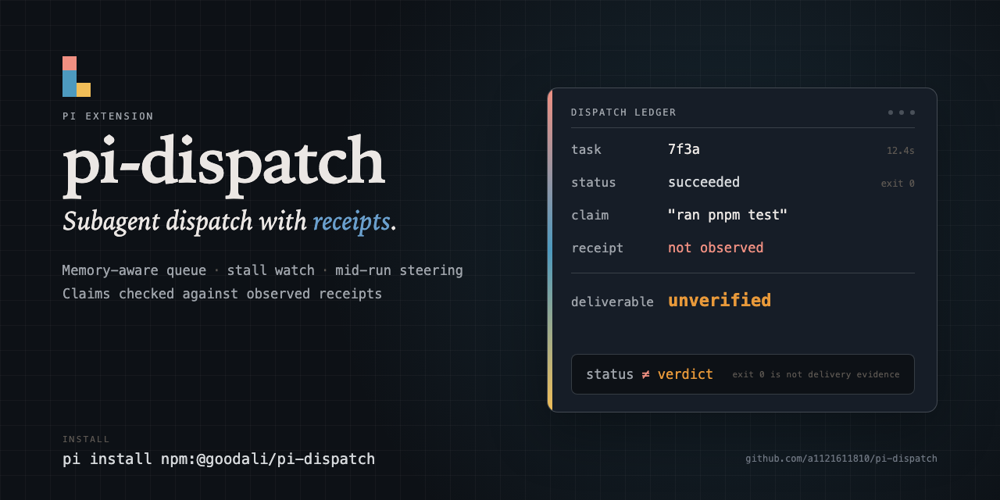

# pi-dispatch

[](https://github.com/a1121611810/pi-dispatch/actions/workflows/ci.yml)
[](https://www.npmjs.com/package/@goodali/pi-dispatch)
[](./LICENSE)

[English](./README.md) · 简体中文

[](https://pi.dev/packages/@goodali/pi-dispatch)

pi 的子代理派发扩展：按内存预算给子代理分席位、排队、盯卡死、能停、能在跑的时候改方向，
并且把子代理自述的和它实际做的对一遍。

> Pi ships with powerful defaults but skips features like sub-agents and plan mode. Ask Pi to
> build what you want, or install a package that does it your way.
> — [pi 官方 README](https://github.com/earendil-works/pi)

**一次派发回来两个独立的结论：进程是怎么退出的，子代理声称的事和它实际做的是否对得上。**
这两笔账分开记，不合并。

```
parent session
  │
  ├─ dispatch_task  ──▶ seat pool ──▶ child pi ──▶ tool calls
  │                     (memory budget)
  │                     └─ no seat free? queue, FIFO, never reject
  │
  ├─ dispatch_steer ──▶ mailbox ──▶ child reads at next turn boundary
  ├─ dispatch_stop  ──▶ SIGTERM ──▶ SIGKILL
  │
  └─ dispatch_list  ◀── ledger ◀── receipts
                        └─ ~/.pi/dispatch/<project bucket>/
                           status      = exit code
                           deliverable = claims vs receipts
```

## 安装

两种装法装到的是同一份产物：

```bash
pi install npm:@goodali/pi-dispatch
```

```bash
pi install git:github.com/a1121611810/pi-dispatch
```

git 装法跟 `main` 走，末尾加 `@v0.1.1` 就钉住版本。npm 装法加 `@0.1.1`。

用带 scope 的名字。npm 上的裸名 `pi-dispatch` 是另一个作者的项目。

pi 找不到扩展入口时不报错，只是静默跳过。装完确认一下确实加载了：

```bash
pi -p "派一个任务，把它的 taskId 给我"
```

回得出 `taskId` 就是装对了。没有的话，先看工具表里有没有 `dispatch_task`——入口没加载是这条
自检要找的失败。

## 环境要求

- Node.js >= 22.19.0
- `@earendil-works/pi-coding-agent` >= 1.0.0（peer）
- 宿主模式：`rpc` 和 `tui` 异步派发，跑完再通知；`print` 和 `json` 一路等到终态，因为一次性
  宿主进程会先退出，后台跑的子代理就没法把交付物交回来。

## 它做什么

**排队。** 席位从内存池里切：可用内存先扣掉总内存 10% 的预留，每席取 512 MiB 和总内存 2% 里
大的那个。长驻宿主里席位用完就按 FIFO 等；一次性宿主腾不出席位，直接返回
`machine is too tight`，不挂着等。

**盯住。** 子代理没有任何活动、并且没有在飞的工具调用，判定为卡住，收掉。阈值默认 5 分钟，
可配，0 是关掉。

**能停。** `dispatch_stop` 把排队中的抽掉，对在跑的先 SIGTERM 再 SIGKILL。停一个不影响别的。

**转向。** `dispatch_steer` 往信箱里写一条，孩子在下一个回合边界读到后调整方向。在飞的工具
调用不会被打断。单条最多 4096 字符，一个任务最多 16 条。

**留痕。** 每次被接受的派发在 `~/.pi/dispatch/<项目桶>/` 落一条记录，原子写、压缩归档、重启
恢复。被闸挡下、或被一次性宿主容量检查退回的派发，在拿到编号之前就返回了，不留记录。

**核对交付。** 报告可能从工具通道来、从 prompt 里的 JSON 块来，也可能没有。它自述写了哪些文件，
拿 `edit` / `write` 的收据逐条对；自述跑过哪些命令，拿观测到的命令收据对。
见[核对：自述与收据](#核对自述与收据)。

## 它适合谁

pi 自带 `examples/extensions/subagent`，是一份可以拷走改的参考实现：单个子代理、最多 8 个并行
任务（同时跑 4 个），或者一条链。它是示例，不是维护中的包。形状对得上，拷它就行。

这个生态里已经有成熟的包。下面每行写的是那个包最强的一件事，都出自它自己的文档：

- [`pi-subagents`](https://github.com/nicobailon/pi-subagents) —— 脚本化的多智能体工作流、missions、可配的 acceptance gate。
- [`@tintinweb/pi-subagents`](https://github.com/tintinweb/pi-subagents) —— Claude Code 风格的命名智能体，带队列和实时面板。
- [`@quintinshaw/pi-dynamic-workflows`](https://github.com/QuintinShaw/pi-dynamic-workflows) —— JavaScript 扇出，带 journaled resume。
- [`pi-better-subagents`](https://github.com/1aboveio/pi-better-harness/tree/main/packages/pi-better-subagents) —— 在 OS 沙箱里跑独立进程。

这个包跟它们的区别是两个设计选择，都在**默认值**这一层，不是功能多少：

|                  | pi-dispatch                     | 一个写死的并发上限       |
| ---------------- | ------------------------------- | ------------------------ |
| 什么时候等       | 席位按可用内存算，扣掉 10% 预留 | 你写下的那个数字         |
| 一次派发回来什么 | 退出码**加上**拿收据核过的判词  | 退出码加上孩子自己的总结 |

上面这些包也核对交付：跑一条你配的命令，或者叫别的模型投票。这个包读的是父方已经观测到的
`edit`、`write` 和命令收据，所以没有要配的东西。是另一种机制，不是更强。

它们比这个包强的地方：OS 沙箱、journaled resume、工作流与人格系统、实时界面。需要那些就用它们。

_包描述是 2026-11-26 对着上游文档核的。上游动得快，用之前自己再确认一遍。_

## 核对：自述与收据

子代理最后写的报告是一种自述，收据是 pi 实际观测到它做的事。一次派发结束时有两个分开算的值：

- `status` —— 进程结果。退出码决定 `succeeded` 还是 `failed`；`canceled`（没开跑就被抽队）和
  `lost`（对账时丢失）是生命周期结局，背后没有退出码。这几种都不说明质量。
- `deliverable` —— 自述有没有收据支撑。

| `deliverable` | 含义                                                                         |
| ------------- | ---------------------------------------------------------------------------- |
| `verified`    | 自述的每个路径和每条命令都在收据里找到了。                                   |
| `unclaimed`   | 有报告，但没声称改过文件或跑过命令，没有可核对的东西。只读分析就是这种形态。 |
| `partial`     | 部分对上了，记录里带对上多少。                                               |
| `unverified`  | 有自述，但收据不支持。                                                       |
| `absent`      | 没有报告、正文空、没有改动。退出码 0 但什么都没干的子代理落在这里。          |

`unverified` 还包括：有正文没报告、报告早于最后一次转向、自评空转、收据被截断且仍有自述对不上。
它的意思是**没有观测到证据**，不是断定它在撒谎。用 `bash` 或 `sed -i` 改的文件
进不了路径收据（命令本身能进），写成 `..` 的路径要先按工作目录解析才能匹配，所以一个老实的
子代理也可能被标成 `unverified`。记录只陈述观测到什么，不是判定它撒谎。

精确的匹配规则——路径后缀匹配、复合命令按段判定、收据 20 条上限——写在
[`docs/spec/core-spec.html`](./docs/spec/core-spec.html)。

## 工具

| 工具                  | 作用                                             |
| --------------------- | ------------------------------------------------ |
| `dispatch_task`       | 派一个子代理。`taskDescription` 必填，其余可选。 |
| `dispatch_list`       | 查记录：状态、时长、用量、报告、收据。           |
| `dispatch_blackboard` | 读本会话的共享黑板。只读。                       |
| `dispatch_steer`      | 改在跑孩子的方向。只受理 running。               |
| `dispatch_stop`       | 停任务：排队中的抽掉，在跑的给信号。             |

`dispatch_task` 的可选参数有 `readOnly`（`strict` 或 `lenient`）、`model`、`thinkingLevel`、
`timeoutMs`、`projectContext`、`allowScripts`、`isolation`、`blackboard`、`usageBudget`。

## 隔离与黑板

两个都默认关。都关着时，记录、argv、孩子的工具表和磁盘目录跟一次普通派发完全一致。

**`isolation: "worktree"`** 把子代理放进独立 git worktree，干净检出。三条代价：检出里没有
`node_modules`，要跑测试得自己装依赖；子代理必须自己 commit，父方不代提交；merge 归父方——
review 完自己 `git merge --ff-only pi-dispatch/<taskId>`，然后移除 worktree、删分支。不在 git
仓库里会被拒绝，不留记录。**隔离不等于沙箱**：它隔离工作目录，不隔离网络、进程和主目录。

**`blackboard: true`** 给本会话的子代理一块共享板，可以读也可以写，父方用 `dispatch_blackboard`
读。**板上的话都不可信**：每条消息带 `trust=unverified`，文件里自报的信任不认。当线索看，别当
事实。作者戳是工具契约，不是安全边界。`readOnly: "strict"` 的孩子照样能读写这块板。只有一个
孩子时没人交换，这块板只是噪音。

## 已知边界

- **转向在回合边界送达。** 在跑的长工具不会被打断，消息要等当前工具批次跑完才进上下文。`sent`
  只表示写进了信箱。送达是另一个收据状态：`queued`、`delivered`、`seen`、`undelivered`。
- **最后一次 `turn_end` 之后写进去的转向永远送不到。** 子代理退出即结束，不重放。父方看到
  `undelivered`，要补就重新派。
- **报告可能早于最后一次转向。** 工具通道的报告比最后一次送达的转向还早时，记录标为过期，
  失去小窗资格。
- **一次性宿主没有插话窗口。** `print` 和 `json` 里父方阻塞在 `dispatch_task`，转向只在 `rpc`
  和 `tui` 有意义。
- **通知在 turn 边界投递。** 长驻宿主的完成通知要等到**下一个** turn 才到模型眼前。turn N 结束
  时完成的孩子，最早 turn N+1 才被看到。
- **同步等待可能很长。** `print` 和 `json` 里父方的工具调用会一直挂着，直到孩子跑完。有
  `timeoutMs` 和卡住判定兜底。
- **席位为 0 时直接返回。** 机器太挤时 `seatCap` 是 0，这个进程里没有子代理能跑完并腾出席位，
  所以返回 "machine is too tight"，不让父方挂死。
- **`readOnly: "strict"` 不是沙箱。** 它挡写，不挡读。

## 文档

- [`docs/spec/core-spec.html`](./docs/spec/core-spec.html) —— 设计与交付判词规则
- [`GLOSSARY.md`](./GLOSSARY.md) —— 记录、收据和规格里用到的术语
- [`CHANGELOG.md`](./CHANGELOG.md) —— 每个版本改了什么
- [`CONTRIBUTING.md`](./CONTRIBUTING.md) —— 构建、测试和破坏点纪律
- [`AGENTS.md`](./AGENTS.md) —— 给编码智能体的工作说明
- [`workflows/release.md`](./workflows/release.md) —— 发版流程

## 许可证

MIT，见 [LICENSE](./LICENSE)。
